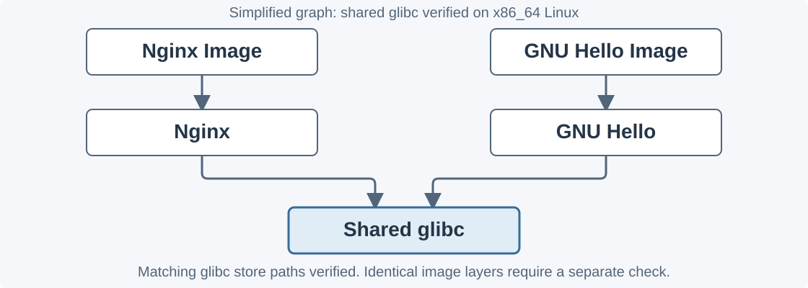
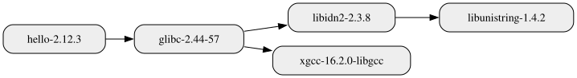
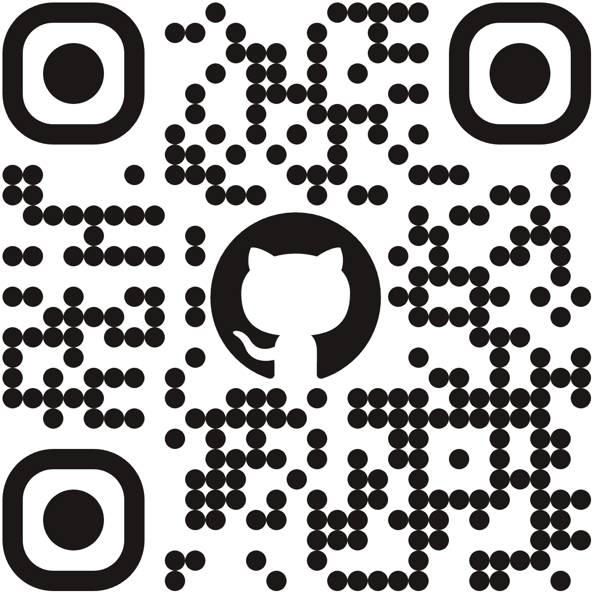

<!-- markdownlint-disable MD033 -->
<style>
@import url('https://cdn.jsdelivr.net/npm/@fortawesome/fontawesome-free@7.1.0/css/all.min.css');

/* Use Noto Emoji font. */
/* https://github.com/orgs/marp-team/discussions/315#discussioncomment-2863387 */

@import url(https://fonts.googleapis.com/css2?family=Noto+Color+Emoji);

/* Override Uncover theme. */
section {
  font-family: -apple-system, BlinkMacSystemFont, 'Segoe UI', Roboto, Oxygen, Ubuntu, Cantarell, 'Open Sans', 'Helvetica Neue', sans-serif, "Noto Color Emoji";
}

/* Apply to every slide. */
section {
  background-image: url('assets/nix-wallpaper-nineish.webp');
  background-size: cover; /* contain; */
  background-position: center;
  background-repeat: no-repeat;
}

footer {
  color: #000000;
  font-size: 0.5rem;
}

/* Pagination "X / Y" — from neobeam. */
section::after {
  font-size: 1rem;
  padding-right: 0.4em;
  padding-bottom: 0.4em;
  content: attr(data-marpit-pagination) ' / ' attr(data-marpit-pagination-total);
}

span[class^="nix-snowflake-"] {
  display: inline-block;
  width: 1em;
  height: 1em;
  background-repeat: no-repeat;
  background-position: center;
  background-size: contain;
  vertical-align: middle;
}

span.nix-snowflake-colours {
  background-image: url('assets/nix-snowflake-colours.svg');
}

span.nix-snowflake-rainbow {
  background-image: url('assets/nix-snowflake-rainbow.svg');
}

span.nix-snowflake-white {
  background-image: url('assets/nix-snowflake-white.svg');
}

/* Fit the Uncover theme decorative quotation marks to the quoted text. */
blockquote {
  width: fit-content;
  margin-left: auto;
  margin-right: auto;
}

section.container-comparison .columns {
  display: grid;
  grid-template-columns: 1fr 1fr;
  gap: 24px;
  text-align: left;
}

section.container-comparison h3 {
  font-size: 28px;
  margin: 0 0 12px;
}

section.container-comparison pre {
  font-size: 19px;
  line-height: 1.35;
  margin: 0;
}

section.container-comparison .columns p {
  font-size: 22px;
  line-height: 1.3;
}

section.container-comparison > p {
  font-size: 24px;
}
section.dependency-graph h2 {
  font-size: 52px;
}

section.dependency-graph > p {
  font-size: 26px;
}

section.contact h2 {
  font-size: 52px;
  margin: 0 0 12px;
}

section.contact > p {
  font-size: 26px;
  margin: 10px 0;
}

section.contact img {
  width: 260px;
  height: 260px;
  padding: 16px;
  background: white;
}
section.workflows h2 {
  font-size: 48px;
}

section.workflows table {
  font-size: 26px;
  line-height: 1.35;
}

section.workflows > p {
  font-size: 28px;
  line-height: 1.4;
}
section.verification h2 {
  font-size: 44px;
  margin: 0 0 12px;
}

section.verification pre {
  font-size: 20px;
  line-height: 1.25;
  margin: 8px 0;
}

section.verification > p {
  font-size: 24px;
  line-height: 1.3;
  margin: 10px 0;
}
section.code-comparison .columns > div {
  display: grid;
  grid-template-rows: auto 1fr auto;
  min-width: 0;
}

section.code-comparison .columns pre {
  box-sizing: border-box;
  width: 100%;
  max-width: none;
  margin: 0;
  align-self: stretch;
  height: 246px;
  background: var(--color-background-code);
  --preserve-aspect-ratio: xMinYMin meet;
}

section.code-comparison .columns pre > code {
  box-sizing: border-box;
  min-width: 0;
  width: 100%;
  margin: 0;
  background: transparent;
}

section.code-comparison .columns p {
  margin: 12px 0 0;
}
section.inspected-dependencies h2 {
  font-size: 48px;
  margin: 0 0 12px;
}

section.inspected-dependencies pre {
  font-size: 20px;
  line-height: 1.3;
  margin: 8px 0 16px;
}

section.inspected-dependencies > p {
  font-size: 24px;
  margin: 10px 0;
}
section.closing-summary h2 {
  font-size: 52px;
}

section.closing-summary ol {
  font-size: 28px;
  line-height: 1.4;
  text-align: left;
}

section.closing-summary li {
  margin: 12px 0;
}
section.shared-layers h2 {
  font-size: 56px;
  margin: 0 0 32px;
}

section.shared-layers .columns {
  gap: 32px;
  margin-bottom: 24px;
}

section.shared-layers .columns > div {
  min-width: 0;
}

section.shared-layers .columns pre {
  box-sizing: border-box;
  width: 100%;
  max-width: none;
  height: 140px;
  margin: 0;
  background: var(--color-background-code);
  --preserve-aspect-ratio: xMinYMin meet;
}

section.shared-layers .columns pre > code {
  box-sizing: border-box;
  min-width: 0;
  width: 100%;
  margin: 0;
  background: transparent;
}

section.shared-layers > p {
  font-size: 26px;
  line-height: 1.4;
  margin: 12px 0 0;
}

section.shared-layers > p:last-of-type {
  font-size: 22px;
}
section.java-toolchain h2 {
  font-size: 54px;
  margin: 0 0 20px;
}

section.java-toolchain pre {
  font-size: 24px;
  line-height: 1.2;
  margin: 0 0 16px;
  --preserve-aspect-ratio: xMidYMid meet;
}

section.java-toolchain pre > code {
  min-width: 0;
  margin: 0 auto;
}

section.java-toolchain > p {
  font-size: 26px;
  line-height: 1.3;
  margin: 8px 0;
}
</style>

## <!--fit--> Reproducible Environments

<!-- markdownlint-disable MD026 -->

### Why Docker Isn't Enough and Why Nix Might Be!

<!--
[30 seconds]

Presenter timing: The session slot is 20 minutes. The slide timings total 16 minutes 30 seconds.
Aim for 16 minutes 30 seconds. Allow up to 18 minutes if needed, leaving at least two minutes for questions and transitions.

Docker solved portability.

It did not solve reproducibility.

In this session, we look at why, and what does.
-->

<br/>
<picture>
  <source srcset="https://fonts.gstatic.com/s/e/notoemoji/latest/1f4e6/512.webp" type="image/webp">
  
</picture>

---

## The "Works on My Machine" Contradiction

​🧑‍💻 It ran on production.

​🚚 Docker shipped the contents.

​🤔 So why does it _not_ work _now_?

<!--
[45 seconds]

We all know the line.

Docker answered it by shipping the runtime environment, so the running artifact travels with you.

That solved portability.

It did not, on its own, make the build itself reproducible.

Same recipe, different result, and that gap is the problem this talk addresses.
-->

---

## The Docker Myth

> "I have a Dockerfile, so my environment is replicable."

Portable? Potentially. (Timing, Architecture, etc.) 🤔

Reproducible? Not really. ❌

<!--
[45 seconds]

Here is the comfortable myth.

A Dockerfile feels like a reproducible specification.

But a Dockerfile is a script of imperative steps, and it runs against a changing environment: package mirrors, the network, and "latest" tags.

Portable means the image runs anywhere.

Deterministic means the same inputs always produce the same output.

Docker provides portability.

Reproducibility requires more work, and we will see how.
-->

---

## The Reality of Drift

```dockerfile
FROM node:24

RUN apt-get update && \
    apt-get install --assume-yes curl
```

​📅 `apt-get update` last month ≠ next month.

​🏷️ `node:24` is a moving target.

​🌐 An outside network dependency leaks in.

<!--
[45 seconds]

Look at three lines almost every image starts with.

"apt-get update" pulls whatever the mirror serves right now, so today's versions differ from yesterday's.

"node:24" is a tag, not a fingerprint, and it is republished upstream.

And the build layer cache quietly hides all of this.

Build this image in June and in December and you get two different machines from identical text.

That is drift.
-->

---

## <!--fit--> Docker: The Imperative Standard

<!--
[15 seconds]

So let us give Docker a fair hearing.

Docker is the imperative model, and it earned that position for good reasons.
-->

---

## How Docker Works

Each step depends on the results of the previous step.

`Layer 1` ⬅️ `Layer 2` ⬅️ `Layer 3`

Each instruction stacks a new layer.

<!--
[45 seconds]

Docker is imperative: do this, then this, then this.

Each instruction adds a layer on top of the last, and the layers cache.

That model is easy to read top to bottom and easy to teach.

It is also exactly why it drifts, because every step depends on both the previous step's output and whatever the outside world provides.
-->

---

## Docker: Strengths

​🌍 **Ubiquity.** A universal language of operations.

​🧱 **Kernel-level isolation.** Namespaces isolate processes; cgroups control resources.

​🚀 **Ubiquitous registries.** The registry is everywhere.

<!--
[60 seconds]

Docker's strengths are real.

Everyone knows it, so it is a shared language between developers and operations.

Internally, Linux namespaces give processes their own views of things such as the process tree, network interfaces, mounts, and hostnames.

Cgroups limit and account for resources such as CPU and memory.

Together, they create a practical runtime boundary without the overhead of a virtual machine.

It is strong isolation, but not an absolute security boundary: containers still share the host kernel.

And the registry ecosystem means an image can run on a laptop, in CI, and in production.

This is why Docker won, and none of that is going away.
-->

---

## Docker: Weaknesses

​🐘 **Opaque bloat.** Often a _whole OS_ to run _one_ program.

​🎲 **Mutable base.** _When_ `node:24` shifts upstream, your build _shifts_.

​🔁 **Recipe, not a fingerprint.** Dockerfile contains same steps often produce different outputs.

<!--
[45 seconds]

The weaknesses follow from the same model.

Without careful base image selection, even a simple app drags a full operating system along, which is bloat and, worse, attack surface.

The base image is mutable, so upstream changes silently rewrite your foundation.

And because the Dockerfile describes steps rather than a fingerprint of inputs, two builds of the same file can disagree.

Save the image by digest and it is frozen.

Rebuild from the same Dockerfile and the result may differ.
-->

---

## <!--fit--> Nix: The Functional Challenger

<!--
[15 seconds]

Now the challenger.

Nix comes at the same problem from the opposite direction: not "run these steps" but "compute this result."
-->

---

## The Core Idea

Nix describes a build through its declared inputs.

$$
\text{Output} = f(\text{Inputs})
$$

Inputs: source, dependencies, compiler, flags.

Change a declared input ➡️ the build identity changes.

<!--
[60 seconds]

Here is the whole idea on one slide.

Nix treats a build as a pure function.

The inputs are everything that matters: the source code, every dependency, the exact compiler, the build flags, the environment.

Nix hashes all of it into one identifier.

That hash is computed before the build runs, which is how the binary cache works: if the hash already exists upstream, Nix downloads the result instead of building it.

The same declared inputs identify the same build. Identical output still requires a deterministic build process.

Change one input by a single byte and the hash changes, so you can always see which input changed.

This is what the functional model gives you: builds you can reason about like math instead of like weather.
-->

---

## The Nix Store

Nix stores packages and their dependencies at:

`/nix/store/<hash>-<name>`

​🔐 The hash is the fingerprint of every input.

​🤝 Multiple package versions can coexist.

<!--
[45 seconds]

Where do these outputs go?

Into the Nix store, each under a path stamped with that input hash.

Two consequences.

First, the path identifies the build inputs. It does not prove that independent builds produce identical bytes.

Second, because the hash disambiguates, many versions of the same library coexist without conflict.

No more "which OpenSSL is active."

Both versions coexist, each addressed by its own hash.
-->

---

## Nix Flakes

Offer lockfile for all external inputs:

```nix
# flake.nix

inputs.nixpkgs.url =
  "github:NixOS/nixpkgs/nixos-26.05";
```

​📌 `flake.lock` pins every input to an exact hash.

<!--
[45 seconds]

Flakes make this practical.

A flake declares your inputs, and the flake.lock pins each one to an exact Git commit hash.

Check that lockfile into the repository and your teammate, your CI runner, and you in six months all resolve the identical dependency graph.

It is the lockfile idea you know from application dependencies, raised to cover the whole toolchain.
-->

---

<!-- _class: java-toolchain -->

## A Shared Java Toolchain

```nix
# flake.nix
{
  inputs.nixpkgs.url = "github:NixOS/nixpkgs/nixos-26.05";
  outputs = { nixpkgs, ... }: {
    devShells.x86_64-linux.default =
      let packages = nixpkgs.legacyPackages.x86_64-linux;
      in packages.mkShell {
        packages = [ packages.jdk21 packages.maven ];
      };
  };
}
```

Commit `flake.nix` and `flake.lock`.

Run `nix develop`.

<!--
[50 seconds]

Here is a concrete example for a Java project on x86_64 Linux.

The input selects Nixpkgs. The lockfile records the resolved revision and content hash.

The development shell supplies JDK 21 and Maven from that revision.

Run nix develop to use these tools. Commit both files so teammates can use them too.

In CI, nix develop --command mvn verify runs Maven with those tools.

Other platforms need corresponding devShells entries. Maven dependencies still need their own dependency controls.

A development shell also inherits parts of the host environment. It is not a container or a sandboxed package build.

Source: [Nix Development Shells][nix-development-shells].
-->

---

## Reproducibility Has Limits

📌 A lockfile fixes declared inputs.

🔧 Build steps must also produce deterministic output.

🔍 Verify independent rebuilds before claiming identical bytes.

<!--
[40 seconds]

Pinning inputs is necessary, but it is not the complete test.

A compiler can embed a timestamp. A build can depend on file ordering or undeclared host state.

Nix provides input tracking and build isolation to reduce these problems.

It does not automatically repair every build process.

Keep the target platform fixed, control the inputs, then compare independent build outputs.

Source: [NixOS Reproducible Builds][nixos-reproducible-builds].
-->

---

## <!--fit--> Nix and Docker Together

<!--
[10 seconds]

Here is the part I want you to remember.
-->

---

<!-- _class: workflows -->

## Two Ways to Combine Nix and Docker

| Workflow                  | Image Assembly                                                               |
| ------------------------- | ---------------------------------------------------------------------------- |
| Keep a Dockerfile.        | Copy the Nix application output and its runtime dependencies into the image. |
| Build the image with Nix. | Use `dockerTools.buildLayeredImage` to assemble it directly.                 |

**Nix can build the application, or it can build the entire container image. Your familiar container runtime can still run the result.**

<!--
[35 seconds]

There are two useful starting points.

Keep your Dockerfile and use Nix to build the application. Copy its runtime dependency closure too; the executable alone may not run.

Alternatively, let Nix assemble the container image directly with dockerTools. A Dockerfile is not required for this approach.

Docker or another compatible container runtime can run either image.

Our GNU Hello example demonstrates the second workflow: Nix selects the package and assembles the image.

Source: [Nixpkgs Container Builders][nixpkgs-container-builders].
-->

---

<!-- _class: container-comparison code-comparison -->

## Dockerfile vs. Nix: GNU Hello

<div class="columns">
<div>

### Dockerfile

```dockerfile
FROM debian:trixie-slim
RUN apt-get update && \
    apt-get install --assume-yes \
      --no-install-recommends hello && \
    rm --recursive --force /var/lib/apt/lists/*
ENTRYPOINT ["hello"]
```

Extend a distribution image with installation commands.

</div>
<div>

### Nix Expression

```nix
packages.dockerTools.buildLayeredImage {
  name = "hello";
  contents = [ packages.hello ];
  config = {
    Entrypoint = [
      "${packages.hello}/bin/hello"
    ];
  };
}
```

Assemble the files required by the selected program.

</div>
</div>
</div>

_One runtime format, two ways to specify the contents._

<!--
[50 seconds]

Both examples package GNU Hello. The container prints a greeting and exits; it needs no ports or server configuration.

The Dockerfile starts from Debian and adds GNU Hello. Rebuilding later can select different files unless we also fix the base and repository inputs.

The Nix expression selects GNU Hello from our locked Nixpkgs revision. Its executable path connects the image to the libraries GNU Hello needs.

We include those referenced files without first installing a distribution into the image.

Docker builds can also be small and repeatable with suitable input controls. Nix records package relationships, but the underlying build must still behave deterministically.

Sources: [Nixpkgs Container Builders][nixpkgs-container-builders] and [Docker Build Practices][docker-build-practices]. Comparison inspired by [Arik Grahl’s Container Examples][arik-nixcon], with original code and wording.
-->

---

<!-- _class: dependency-graph -->

## Shared Image Dependencies



Reuse requires the identical library store path and layer blob.

<!--
[45 seconds]

Follow each arrow toward a required component. The diagram illustrates the relationship; it is not an inventory from a particular build.

The presenter compared the Nginx and GNU Hello runtime closures for x86_64 Linux. Both contained /nix/store/dphsh3jff8w6n9p3xbfmkia5krqwv52f-glibc-2.42-103. This verifies the shared dependency for that package selection, not identical image layers. Other revisions and platforms need their own checks.

The image builder uses the package graph when it assigns files to layers. Several store paths can occupy one layer when the layer limit requires grouping.

If that library becomes the same layer in both images, a consumer can retain one copy rather than fetch it again.

Layer reuse is also available to Docker builds. The Nix package graph supplies information for deciding how to divide the image.

Actual dependencies depend on the pinned revision, target platform, and package options.

Sources: [Nixpkgs Container Builders][nixpkgs-container-builders] and [Arik Grahl’s NixCon Talk][arik-nixcon].
-->

---

<!-- _class: verification -->

## Verified Dependencies (Stable/26.05)

Verified on `x86_64-linux`.

```bash
nix build github:NixOS/nixpkgs/nixos-26.05#nginx --out-link nginx
nix build github:NixOS/nixpkgs/nixos-26.05#hello --out-link hello

nix path-info --recursive ./nginx | rg '/[^/]+-glibc-[0-9][^/]*$'
nix path-info --recursive ./hello | rg '/[^/]+-glibc-[0-9][^/]*$'
```

Output from Nginx, then GNU Hello:

```text
/nix/store/dphsh3jff8w6n9p3xbfmkia5krqwv52f-glibc-2.42-103
/nix/store/dphsh3jff8w6n9p3xbfmkia5krqwv52f-glibc-2.42-103
```

**Identical paths confirm the shared glibc dependency.**

<!--
[30 seconds]

Source: The presenter supplied these commands and verified outputs.

Both paths match in full, including the store hash. This demonstrates that both runtime closures contain the identical glibc output in this tested package set.

The branch name can advance, so later runs may show different paths. The resolved revision was not recorded with this output.

Dependency sharing is verified here. Identical container layer blobs require a separate check.
-->

---

<!-- _class: verification -->

## Verified Dependencies (Unstable)

Verified on `x86_64-linux`.

```bash
nix build github:NixOS/nixpkgs/nixos-unstable#nginx --out-link nginx
nix build github:NixOS/nixpkgs/nixos-unstable#hello --out-link hello

nix path-info --recursive ./nginx | rg '/[^/]+-glibc-[0-9][^/]*$'
nix path-info --recursive ./hello | rg '/[^/]+-glibc-[0-9][^/]*$'
```

Output from Nginx, then GNU Hello:

```text
/nix/store/pqyiidz5mi73wv5f91d48s9plcqyj5bz-glibc-2.44-57
/nix/store/pqyiidz5mi73wv5f91d48s9plcqyj5bz-glibc-2.44-57
```

**Identical paths confirm the shared glibc dependency.**

<!--
[30 seconds]

Source: The presenter supplied these commands and verified outputs.

Both paths match in full, including the store hash. This demonstrates that both runtime closures contain the identical glibc output in this tested package set.

The branch name can advance, so later runs may show different paths. The resolved revision was not recorded with this output.

Dependency sharing is verified here. Identical container layer blobs require a separate check.
-->

---

<!-- _class: container-comparison shared-layers -->

## Two Images, One Shared Layer

<div class="columns">
<div>

### Nginx Image

```text
manifest
└── layers
    ├── digest A: Nginx files
    └── digest C: shared library
```

</div>
<div>

### GNU Hello Image

```text
manifest
└── layers
    ├── digest B: GNU Hello files
    └── digest C: shared library
```

</div>
</div>

**Both manifests reference C.** The existing blob can serve either image.

Symbolic digests and simplified contents, not measured output.

<!--
[40 seconds]

Now follow the shared library from the package graph into the image format.

A manifest identifies layer content by digest. The application files differ, so they have labels A and B. Both lists point to C for the library.

These letters stand in for digests. This example does not claim to show actual archive output.

After downloading the first image, a runtime may already have C when it receives the second manifest. Reuse saves a transfer and duplicate storage. Application startup still depends on other factors.

This content reuse belongs to the container format, so Docker can benefit too. Nix adds a package graph to guide layer construction. One package does not always equal one layer.

Sources: [Nixpkgs Container Builders][nixpkgs-container-builders] and [OCI Image Manifest Specification][oci-image-manifest]. Example inspired by [Arik Grahl’s Container Examples][arik-nixcon].
-->

---

<!-- _class: inspected-dependencies -->

## Inspect GNU Hello’s Dependencies

```bash
# Generate the software bill of materials.
nix run github:tiiuae/sbomnix#sbomnix -- ./hello

# Generate the runtime dependency graph.
nix run github:tiiuae/sbomnix#nixgraph -- \
  ~/hello --depth=4 --out=hello-dependencies.svg
```



Verified runtime dependency graph, generated with `--depth=4`.

<!--
[60 seconds]

These commands continue from the GNU Hello output already built on x86_64 Linux. The graph command uses ~/hello, as requested, and generates hello-dependencies.svg at depth 4.

sbomnix generates a software bill of materials. Its default inventory covers runtime dependencies and supports SPDX and CycloneDX output.

nixgraph reads the existing output and draws its recorded runtime dependencies. The displayed SVG is the supplied deeper graph and includes libunistring.

The graph shows GNU Hello 2.12.3 referencing glibc 2.44-57. glibc references libidn2 2.3.8 and xgcc 16.2.0-libgcc. libidn2 references libunistring 1.4.2.

The libgcc runtime library is not the complete compiler toolchain. A runtime dependency graph must not be confused with a graph of all build tools.

The depth argument limits how far the graph follows dependencies. The same glibc store path appears in our unstable dependency verification.

An inventory supports inspection; it does not certify that the application is secure.

Sources: User supplied commands and hello-dependencies.svg, plus [sbomnix Documentation][sbomnix-documentation].
-->

---

## My Two Cents

Ship a black box to production? ➡️ **Docker.**

Share pinned development and CI tools? ➡️ **Nix.**

Want both? ➡️ **Build with Nix, ship with Docker.**

<!--
[45 seconds]

So the decision rule.

If your job is to hand a running black box to production, a Dockerfile is a fine and familiar answer.

If your job is to share pinned tools between your development machine and your CI pipeline, that is where Nix excels.

And on a serious project, the answer is usually both, in that order.
-->

---

<!-- _class: closing-summary -->

## Summary

1. **Portability differs from reproducibility.** Shipping an image does not fix its rebuild inputs.
2. **Nix makes inputs explicit.** A flake lockfile records resolved inputs.
3. **Keep the Dockerfile or build the image with Nix.** Both workflows use familiar container runtimes.
4. **Shared dependencies are verifiable.** Nginx and GNU Hello contained the same glibc store path in both tests.
5. **Inspect what you ship.** Graphs show relationships; SBOMs record components and versions for tools.

<!--
[30 seconds]

An image preserves an artifact. Rebuilding it reproducibly also requires controlled inputs and deterministic build steps.

Nix can build the application and its runtime dependencies for a Dockerfile, or assemble the entire image directly.

Our tests confirmed shared glibc outputs within each package set. Identical image layers remain a separate check.

Use the dependency graph to explain relationships and the SBOM to inventory and investigate components. Neither is a security guarantee.
-->

---

<!-- _class: contact -->

## Follow and Get in Touch

<!-- markdownlint-enable MD026 -->

<!-- markdownlint-disable MD036 -->

[github.com/sheeeng][github-profile]



Follow me on GitHub. Contact details are on my profile.

`sheeeng.github.io/slides`

<!-- markdownlint-enable MD036 -->

<!--
[30 seconds]

Thank you!

Scan this code to open my GitHub profile. Follow me there and use the contact details on my profile to get in touch.

The slides link is also available below the code.

Questions?
-->

[github-profile]: https://github.com/sheeeng
[nix-development-shells]: https://nix.dev/manual/nix/2.20/command-ref/new-cli/nix3-develop
[nixos-reproducible-builds]: https://reproducible.nixos.org/
[arik-nixcon]: https://www.arik-grahl.de/talks/nixcon-2026/
[nixpkgs-container-builders]: https://github.com/NixOS/nixpkgs/blob/master/doc/build-helpers/images/dockertools.section.md
[sbomnix-documentation]: https://github.com/tiiuae/sbomnix
[docker-build-practices]: https://docs.docker.com/build/building/best-practices/
[oci-image-manifest]: https://github.com/opencontainers/image-spec/blob/main/manifest.md
